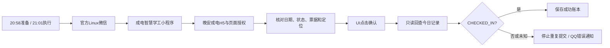

# 晚安成电：Linux 微信自动点击

> **源码已于2026-10-28封存。** 最终归档包含UI版本`2026.10.27.1`及其测试；源码已与当时运行中的安装逐项核对，路径和示例配置经过脱敏，见[归档清单](ARCHIVE.json)。以下文档保留作历史参考，仓库不再维护。封存源码本身不代表某台服务器已经切换或停止运行。

在 Linux 服务器的 Docker 容器中运行官方微信，通过浏览器远程操作；每天进入「成电智慧学工 → 学生管理 → 晚安成电」，让小程序完成自己的授权流程，再执行页面点击并回读学校记录确认结果。

这是从个人部署整理出的参考实现。**原部署已在2026年10月24日、25日连续两晚完成签到；公开版经过脱敏、目录调整和离线回归，尚未在全新服务器完成整套部署及学校端到端验证。** 它需要人工准备客户端、首次扫码登录和配置，不是一键即用的软件。

## 为什么换方案

我们之前使用的接口方案，虽然能通过统一身份认证并拿到业务会话，提交时仍返回 `46001`。后续检查发现，页面还有 `daily-checkin-operation-ticket`，实际提交依赖额外的操作票据。**能进入网页、CAS登录成功、业务会话有效，都不等于已经取得本次操作授权。** 在微信之外直接打开H5时，我们实际观察到该字段不存在。本文不把错误码46001单独视为所有失败的统一原因。

所以我们采用官方 Linux 微信完成页面授权，并通过实际界面提交；不离线生成票据、不把抓到的临时值硬编码到脚本，也不直接重放签到POST。

### 其他项目现在是什么情况

核对日期：**2026-10-26，北京时间**。不能笼统地说“其他人的方案现在都不可用”。

| 项目或方法 | 目前能确认的情况 |
| --- | --- |
| 我们当时使用的旧接口方案 | 未覆盖新增票据流程，在我们的账号与部署环境下无法完成签到。重新登录并不能单独解决这一问题。 |
| [UESTC-MoonCheck旧桌面版](https://github.com/richard297779/UESTC-MoonCheck/blob/3465b403884354009caff93a07c5d3345e124b15/desktop/README.md) | 上游说明桌面版尚未实现新增微信操作票据流程，因此不适配这项新要求。 |
| [UESTC-MoonCheck固件v0.5.1](https://github.com/richard297779/UESTC-MoonCheck/blob/3465b403884354009caff93a07c5d3345e124b15/README.md) | **上游已更新源码并加入票据申请流程。我们尚未实测新固件，不能再用旧版失败推断它仍不可用。** 若关心资源占用，可先评估这条更新路线。 |
| [GoodNight](https://github.com/beichenO2/GoodNight) | 上游是浏览器自动化路线，README明确区分历史macOS验证和新移植版本尚未完成的学校端到端验证；本项目不据此判定它全面失效。 |
| 本项目 | 官方Linux微信、小程序页面流程、UI点击与结果核验；原部署两晚成功，仍受版本、登录状态和页面改版影响。 |

## 我们的实现



- **桌面**：Xvfb + 官方Linux微信 + noVNC，由Nginx提供HTTPS和独立账号密码。6080只映射宿主机回环地址，VNC与CDP均不对公网发布。
- **页面访问**：基于[evi0s/WMPFDebugger及其贡献者](https://github.com/evi0s/WMPFDebugger)，固定已验证的提交、WMPF版本及渲染器SHA256。进程或版本不符时停止，不套用旧偏移。
- **定位**：当前文档内的H5定位API覆盖，加上页面地图路由坐标同步。**它不是Linux系统GPS，也不代表原生`wx.getLocation`已被修改。** 仓库不含作者实际位置，配置必须自行填写WGS84和GCJ-02值。
- **提交与核验**：仅在脚本的21:01–23:00窗口、今日状态`PENDING`且所有检查通过时点击。确认前持久化提交意图；提交后只把学校回读的当日`CHECKED_IN`视为成功。结果未知时停止，避免重复提交；不自动改填其他情况报告。
- **通知**：AstrBot私聊QQ，成功安静；渲染成功只发图片，渲染失败只发文字。验证码、MFA或失效认证会暂停自动操作，等待本人处理。
- **记住账号入口**：最终UI版本只在原生窗口类别、尺寸和“进入微信”按钮图像及文字严格匹配、位置连续稳定时点击一次；扫码页、手机确认、验证码、锁定或未知界面停止。已进入主窗口则不点击。此入口不会直接触发签到。
- **维护**：每天04:20加密备份、04:50通过微信自身功能清空本客户端聊天记录；维护锁最多等待30秒，暂时忙碌时每分钟补跑，30分钟内最多启动4次。
- **监控**：清理或备份超过36小时未成功、维护补跑超过15分钟未完成、最新备份超过12小时无本地校验回执时告警。连续两次异常再发QQ卡片，相同持续问题去重。

## 运行环境与资源

原部署为2核4GB、Docker CE、Linux x86_64。验证组合是官方微信 **4.1.13.26**、WMPF **25806**、Node **22.23.4**、Python **3.12**。客户端版本号与WMPF版本号是两个不同值。

微信容器在两次检查中约327–358MiB内存、约1% CPU；调试桥接按需启动，会额外占用内存。该数值是空闲时采样，**不是峰值或容量保证**，AstrBot、QQ机器人和备份也消耗资源。

## 部署与文档

- [部署步骤](docs/INSTALL.md)：固定目录、Docker、客户端登录、调试依赖、配置和定时器。
- [操作票据与方案边界](docs/ARCHITECTURE.md)：为什么Cookie不够、哪些步骤已验证、哪些没有。
- [运维与故障处理](docs/OPERATIONS.md)：失败通知、锁补跑、聊天清理、D盘备份和恢复。
- [配置样例](examples/config.example.json)与[Nginx样例](examples/nginx.conf)。
- [上游署名与许可证](THIRD_PARTY_NOTICES.md)。

首次配置后，先执行不提交的演练，再启用定时器：

```sh
sudo python3 /opt/uestc-wechat/scripts/preflight.py
sudo python3 /usr/local/lib/wechat-checkin/checkin.py dry-run
```

## 测试

Linux主机或CI中运行离线合成测试，不需要微信账号，也不会连接学校：

```sh
python3 -m pip install -r requirements.txt
cd checkin
python3 -B -m unittest test_checkin test_cleanup test_persistence test_clear_chat_records test_maintenance test_health test_ui
node test_policy.cjs
```

Windows另运行`python -B -m unittest test_sync_backups`。测试覆盖通知图文互斥、重复提交保护、真实文件锁等待与超时、维护过期与同步回执、图标加载及清空聊天界面保护。CI不包含真实扫码、真实定位或真实签到；通过测试不代表新设备上的学校流程已经成功。

## 当前限制

页面资源导出、UI坐标、1280×900显示分辨率和客户端版本目前均固定。学校或微信更新后可能停止工作。微信重启、失效登录或设备确认仍可能需要手机操作；容器自动重启不能保证免确认。

仅用于本人账号和有权操作的环境。请遵守学校对签到、位置和自动化的要求。位置覆盖会改变页面上报的位置，不证明实际在场。本项目没有规避风控、伪造IP或跳过验证码的功能。

仓库仅发布源码、配置样例和不含用户信息的匹配裁剪，不包含账号、密码、Cookie、操作票据、微信资料、抓包、安装包或运行备份。自行编写代码采用GPL-2.0-only；第三方组件和界面素材权利见[署名文件](THIRD_PARTY_NOTICES.md)。
